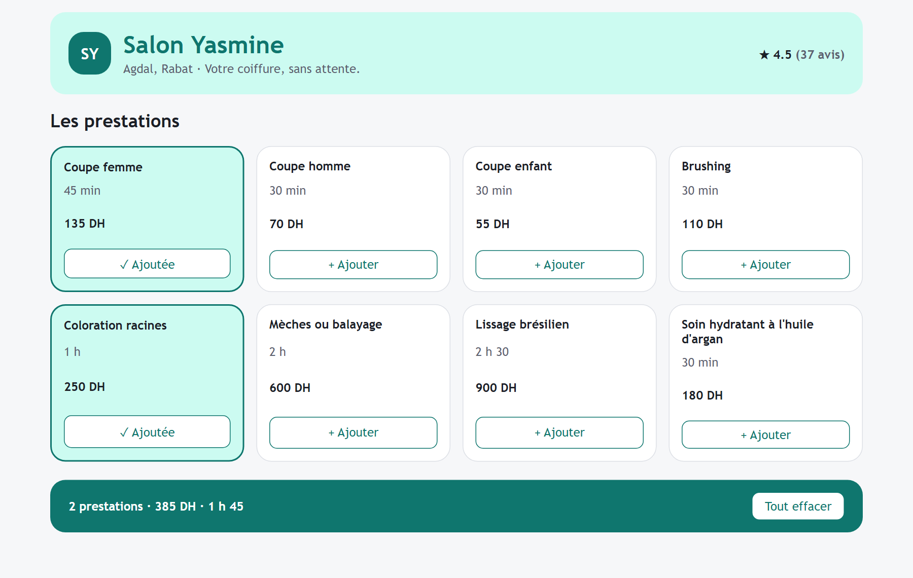

# Séance L1 : la page d'un salon

Composants, props, listes, état et données dérivées en React.

Cette séance complète le projet `mawid-web` créé en séance 2 : en-tête du salon, liste des
prestations, sélection et résumé de la sélection. Chaque étape comporte un rappel de JavaScript,
la notion React correspondante, le code à écrire dans le projet et un commit.
Support de cours : [`L1_page_salon.pdf`](L1_page_salon.pdf).



## Organisation des dossiers

Les commandes ci-dessous supposent que `mawid-web` et `tp-framewok-web` se trouvent dans le
même dossier :

```text
dossier-de-travail/
├── mawid-web/          projet personnel (séance 2)
└── tp-framewok-web/    dépôt des TP
```

Sauf indication contraire, les commandes s'exécutent dans le terminal de VS Code, à la racine de
`mawid-web`.

## Commandes, dans l'ordre de la séance

### 1. Préparation du projet (début de séance)

**Versionner le projet existant.**

```bash
git init                                   # une seule fois
git add .
git commit -m "S2 : projet avant L1"
```

Configuration de Git, une seule fois par ordinateur :
`git config --global user.name "Prénom Nom"` et `git config --global user.email "vous@exemple.ma"`.

**Récupérer les fichiers de la séance et les copier dans `src/`.**

Windows (PowerShell) :

```powershell
cd ..\tp-framewok-web ; git pull ; cd ..\mawid-web
Copy-Item -Recurse -Force ..\tp-framewok-web\live\L1\fournis\src\* .\src\
```

macOS, Linux :

```bash
cd ../tp-framewok-web && git pull && cd ../mawid-web
cp -R ../tp-framewok-web/live/L1/fournis/src/* src/
```

Si le dépôt des TP est absent, le cloner dans le dossier de travail :
`git clone https://github.com/M2P-git/tp-framewok-web.git`.

**Appliquer la feuille de style.** Dans `src/main.jsx`, remplacer `import './index.css'` par
`import './styles.css'`.

**Lancer le serveur de développement, puis enregistrer la version.**

```bash
npm run dev                                # http://localhost:5173
git add .
git commit -m "L1 : fichiers fournis"
```

Si le projet `mawid-web` n'existe pas, le créer comme en séance 2 :
`npm create vite@latest mawid-web -- --template react`, puis `cd mawid-web` et `npm install`.

### 2. Fin de chaque étape : enregistrer la version

| Étape | Fichiers créés ou modifiés | Commande |
| --- | --- | --- |
| 1 · en-tête du salon | `components/EnteteSalon.jsx`, `App.jsx` | `git add .` puis `git commit -m "L1 étape 1 : en-tête du salon"` |
| 2 · liste des prestations | `components/CarteService.jsx`, `components/ListeServices.jsx`, `App.jsx` | `git add .` puis `git commit -m "L1 étape 2 : liste des prestations"` |
| 3 · sélection | `App.jsx`, `components/ListeServices.jsx`, `components/CarteService.jsx` | `git add .` puis `git commit -m "L1 étape 3 : sélection des prestations"` |
| 4 · résumé | `components/ResumeSelection.jsx`, `App.jsx` | `git add .` puis `git commit -m "L1 étape 4 : résumé de la sélection"` |
| exercice B | `App.jsx` | `git commit -am "L1 : filtre par catégorie"` |

La commande `git log --oneline` affiche la liste des versions enregistrées.

### 3. Reprendre à partir de la correction d'une étape

Copier la correction de l'étape dans `src/` (remplacer `etape-2` par l'étape concernée) :

```powershell
Copy-Item -Recurse -Force ..\tp-framewok-web\live\L1\etapes\etape-2\src\* .\src\
```

```bash
cp -R ../tp-framewok-web/live/L1/etapes/etape-2/src/* src/
```

Les versions précédentes restent disponibles dans l'historique Git.

### 4. Publication sur GitHub (fin de séance)

Première publication : sur github.com, créer un dépôt `mawid-web` sans fichier README, puis :

```bash
git branch -M main
git remote add origin https://github.com/compte/mawid-web.git    # compte : identifiant GitHub
git push -u origin main
```

Séances suivantes : `git add .`, `git commit -m "..."`, puis `git push`.

## Contenu du dossier

| Dossier ou fichier | Contenu |
| --- | --- |
| `fournis/src/` | fichiers copiés en début de séance : données des salons (`donnees/salons.js`), mise en forme des prix et des durées (`lib/format.js`), thème des salons (`lib/theme.js`), feuille de style (`styles.css`), page de départ (`App.jsx`) |
| `etapes/etape-1/src/` à `etapes/etape-4/src/` | code à la fin de chaque étape |
| `L1_page_salon.pdf` | support de cours : notions, code et commandes |

La correction des exercices B et C (`etapes/fin/`) est publiée après la séance.

## Difficultés fréquentes

| Symptôme | Solution |
| --- | --- |
| l'affichage ne change pas | enregistrer le fichier (Ctrl+S) ou activer *Fichier*, *Enregistrement automatique* |
| page blanche | ouvrir la console (F12, onglet *Console*) et lire la première ligne en rouge |
| `npm.ps1 ne peut pas être chargé` | exécuter `Set-ExecutionPolicy -Scope CurrentUser RemoteSigned`, puis rouvrir le terminal |
| `Copy-Item` : chemin introuvable | vérifier que `mawid-web` et `tp-framewok-web` sont dans le même dossier, ou copier les fichiers manuellement |
| `git push` refusé | accepter la connexion par le navigateur proposée par VS Code |
